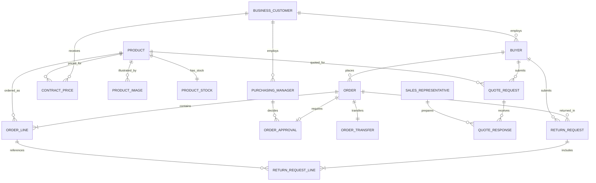

# Entity Model

## Entity Relationship Diagram

### BUSINESS_CUSTOMER

Represents a business account that buys products from Alpenfeld.

| Attribute | Description | Data Type | Length/Precision | Validation Rules |
|---|---|---|---|---|
| id | Unique identifier | Long | 19 | Primary Key, Sequence |
| erp_customer_reference | Customer identifier in the ERP | String | 100 | Not Null, Unique |
| name | Business name | String | 255 | Not Null |
| approval_limit | Order amount above which approval is required | Decimal | 10,2 | Optional |

### BUYER

Represents an employee of a Business Customer who uses the portal to place orders and request quotes or returns.

| Attribute | Description | Data Type | Length/Precision | Validation Rules |
|---|---|---|---|---|
| id | Unique identifier | Long | 19 | Primary Key, Sequence |
| business_customer_id | Business Customer employing the Buyer | Long | 19 | Not Null, Foreign Key (BUSINESS_CUSTOMER.id) |
| name | Buyer's full name | String | 150 | Not Null |
| email | Buyer's email address | String | 255 | Not Null, Format: Email |
| active | Whether the Buyer is authorized to use the portal | Boolean | 1 | Not Null |

### PURCHASING_MANAGER

Represents an employee of a Business Customer who manages Buyers and decides order approvals.

| Attribute | Description | Data Type | Length/Precision | Validation Rules |
|---|---|---|---|---|
| id | Unique identifier | Long | 19 | Primary Key, Sequence |
| business_customer_id | Business Customer employing the Purchasing Manager | Long | 19 | Not Null, Foreign Key (BUSINESS_CUSTOMER.id) |
| name | Purchasing Manager's full name | String | 150 | Not Null |
| email | Purchasing Manager's email address | String | 255 | Not Null, Format: Email |
| active | Whether the Purchasing Manager is authorized to use the portal | Boolean | 1 | Not Null |

### PRODUCT

Represents a product whose catalog data and images are copied from the PIM.

| Attribute | Description | Data Type | Length/Precision | Validation Rules |
|---|---|---|---|---|
| id | Unique identifier | Long | 19 | Primary Key, Sequence |
| pim_product_reference | Product identifier in the PIM | String | 100 | Not Null, Unique |
| product_number | Product number copied from the PIM and shown to Buyers | String | 10 | Not Null, Unique |
| name | Product name | String | 255 | Not Null |
| description | Product description | String | 500 | Optional |
| synchronized_at | Time this product data was copied from the PIM | DateTime | - | Not Null |

### PRODUCT_IMAGE

Represents an image copied from the PIM for a Product.

| Attribute | Description | Data Type | Length/Precision | Validation Rules |
|---|---|---|---|---|
| id | Unique identifier | Long | 19 | Primary Key, Sequence |
| product_id | Product shown in this image | Long | 19 | Not Null, Foreign Key (PRODUCT.id) |
| image_url | Address of the product image | String | 500 | Not Null |
| display_order | Position in the Product's image sequence | Integer | 10 | Not Null |

### CONTRACT_PRICE

Represents the copied price for one Product offered to one Business Customer.

| Attribute | Description | Data Type | Length/Precision | Validation Rules |
|---|---|---|---|---|
| id | Unique identifier | Long | 19 | Primary Key, Sequence |
| business_customer_id | Business Customer receiving this price | Long | 19 | Not Null, Foreign Key (BUSINESS_CUSTOMER.id) |
| product_id | Product with this price | Long | 19 | Not Null, Foreign Key (PRODUCT.id) |
| unit_price | Customer-specific price per unit | Decimal | 10,2 | Not Null |
| synchronized_at | Time this price was copied from the ERP | DateTime | - | Not Null |

#### Constraints

- A Business Customer has at most one Contract Price for a Product.

### PRODUCT_STOCK

Represents the locally copied stock quantity for a Product.

| Attribute | Description | Data Type | Length/Precision | Validation Rules |
|---|---|---|---|---|
| product_id | Product whose stock is recorded | Long | 19 | Primary Key, Foreign Key (PRODUCT.id) |
| quantity | Stock quantity copied from the ERP | Integer | 10 | Not Null |
| synchronized_at | Time this stock quantity was copied from the ERP | DateTime | - | Not Null |

### ORDER

Represents an Order submitted by a Buyer for a Business Customer.

| Attribute | Description | Data Type | Length/Precision | Validation Rules |
|---|---|---|---|---|
| id | Unique identifier | Long | 19 | Primary Key, Sequence |
| buyer_id | Buyer who submitted the Order | Long | 19 | Not Null, Foreign Key (BUYER.id) |
| submitted_at | Time the Order was submitted | DateTime | - | Not Null |
| status | Current Order status | String | 50 | Not Null |

#### Constraints

- The Order amount is the sum of its Order Line quantities multiplied by their unit prices.
- An Order whose amount exceeds its Buyer's Business Customer approval limit requires an Order Approval.

### ORDER_LINE

Represents a Product and its price and quantity within an Order.

| Attribute | Description | Data Type | Length/Precision | Validation Rules |
|---|---|---|---|---|
| id | Unique identifier | Long | 19 | Primary Key, Sequence |
| order_id | Order containing this line | Long | 19 | Not Null, Foreign Key (ORDER.id) |
| product_id | Product being ordered | Long | 19 | Not Null, Foreign Key (PRODUCT.id) |
| quantity | Number of units ordered | Integer | 10 | Not Null |
| unit_price | Contract Price captured when the Order was submitted | Decimal | 10,2 | Not Null |

### ORDER_APPROVAL

Represents a Purchasing Manager's decision for an Order that requires approval.

| Attribute | Description | Data Type | Length/Precision | Validation Rules |
|---|---|---|---|---|
| order_id | Order being reviewed | Long | 19 | Primary Key, Foreign Key (ORDER.id) |
| purchasing_manager_id | Purchasing Manager deciding the approval | Long | 19 | Not Null, Foreign Key (PURCHASING_MANAGER.id) |
| status | Current approval status | String | 50 | Not Null |
| decided_at | Time the approval decision was made | DateTime | - | Optional |

#### Constraints

- The Purchasing Manager must belong to the same Business Customer as the Buyer who submitted the Order.

### ORDER_TRANSFER

Represents the durable transfer record used to send an Order to the ERP.

| Attribute | Description | Data Type | Length/Precision | Validation Rules |
|---|---|---|---|---|
| order_id | Order to transfer | Long | 19 | Primary Key, Foreign Key (ORDER.id) |
| idempotency_key | Stable key used to prevent duplicate ERP order creation | String | 100 | Not Null, Unique |
| status | Current ERP transfer status | String | 50 | Not Null |
| erp_order_reference | Order identifier returned by the ERP | String | 100 | Optional |
| last_attempt_at | Time of the most recent transfer attempt | DateTime | - | Optional |

#### Constraints

- Each Order has exactly one Order Transfer record.
- Repeated transfer attempts for an Order must use the same idempotency key.
- An ERP order reference, when present, identifies no more than one Order.

### QUOTE_REQUEST

Represents a Buyer's request for a quote for a Product and quantity.

| Attribute | Description | Data Type | Length/Precision | Validation Rules |
|---|---|---|---|---|
| id | Unique identifier | Long | 19 | Primary Key, Sequence |
| buyer_id | Buyer submitting the request | Long | 19 | Not Null, Foreign Key (BUYER.id) |
| product_id | Product being quoted | Long | 19 | Not Null, Foreign Key (PRODUCT.id) |
| quantity | Number of units for which a quote is requested | Integer | 10 | Not Null |
| submitted_at | Time the request was submitted | DateTime | - | Not Null |
| status | Current request status | String | 50 | Not Null |

### QUOTE_RESPONSE

Represents a Sales Representative's response to a Quote Request.

| Attribute | Description | Data Type | Length/Precision | Validation Rules |
|---|---|---|---|---|
| id | Unique identifier | Long | 19 | Primary Key, Sequence |
| quote_request_id | Quote Request being answered | Long | 19 | Not Null, Foreign Key (QUOTE_REQUEST.id) |
| sales_representative_id | Sales Representative preparing the response | Long | 19 | Not Null, Foreign Key (SALES_REPRESENTATIVE.id) |
| quoted_unit_price | Price per unit offered in the response | Decimal | 10,2 | Not Null |
| response_text | Details of the response | String | 500 | Optional |
| responded_at | Time the response was submitted | DateTime | - | Not Null |

### SALES_REPRESENTATIVE

Represents an Alpenfeld employee who answers Quote Requests.

| Attribute | Description | Data Type | Length/Precision | Validation Rules |
|---|---|---|---|---|
| id | Unique identifier | Long | 19 | Primary Key, Sequence |
| name | Sales Representative's full name | String | 150 | Not Null |
| email | Sales Representative's email address | String | 255 | Not Null, Format: Email |

### RETURN_REQUEST

Represents a Buyer's request to return items from an Order.

| Attribute | Description | Data Type | Length/Precision | Validation Rules |
|---|---|---|---|---|
| id | Unique identifier | Long | 19 | Primary Key, Sequence |
| order_id | Order containing the items to return | Long | 19 | Not Null, Foreign Key (ORDER.id) |
| buyer_id | Buyer submitting the request | Long | 19 | Not Null, Foreign Key (BUYER.id) |
| reason | Buyer's reason for the request | String | 500 | Not Null |
| status | Current return request status | String | 50 | Not Null |
| submitted_at | Time the request was submitted | DateTime | - | Not Null |

#### Constraints

- The Buyer submitting a Return Request must belong to the Business Customer that placed the Order.

### RETURN_REQUEST_LINE

Represents an Order Line and quantity included in a Return Request.

| Attribute | Description | Data Type | Length/Precision | Validation Rules |
|---|---|---|---|---|
| id | Unique identifier | Long | 19 | Primary Key, Sequence |
| return_request_id | Return Request containing this line | Long | 19 | Not Null, Foreign Key (RETURN_REQUEST.id) |
| order_line_id | Order Line being returned | Long | 19 | Not Null, Foreign Key (ORDER_LINE.id) |
| quantity | Number of units requested for return | Integer | 10 | Not Null |

#### Constraints

- The total quantity requested across all Return Request Lines for an Order Line must not exceed the quantity on that Order Line.