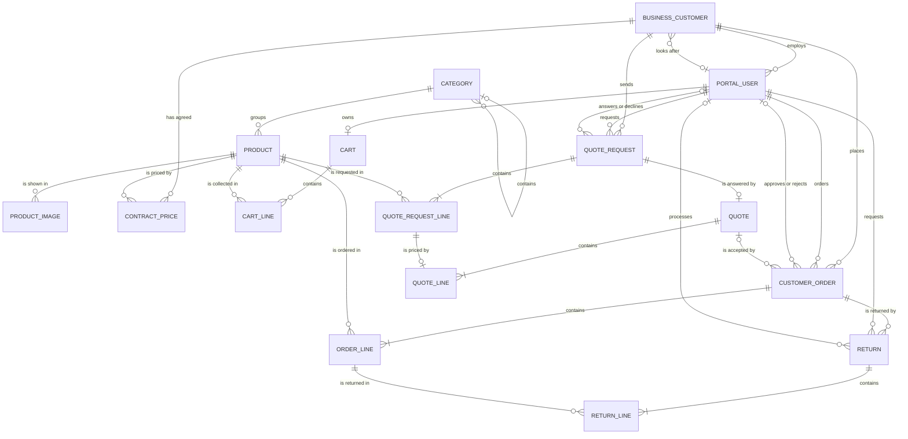

# Entity Model

Source: [requirements.md](requirements.md). Domain terms follow the [glossary](glossary.md).

## Entity Relationship Diagram

### BUSINESS_CUSTOMER

A business that buys from Alpenfeld under its own Contract Prices, optionally looked after as a Key Account by a Sales Representative.

| Attribute               | Description                                                  | Data Type | Length/Precision | Validation Rules             |
|-------------------------|--------------------------------------------------------------|-----------|------------------|------------------------------|
| id                      | Unique identifier                                            | Long      | 19               | Primary Key, Sequence        |
| customer_number         | Number of the Business Customer in the ERP                   | String    | 20               | Not Null, Unique             |
| name                    | Name of the Business Customer                                | String    | 200              | Not Null                     |
| sales_representative_id | Sales Representative who looks after it as a Key Account    | Long      | 19               | Optional                     |

#### Constraints

- If sales_representative_id is set, it must reference a PORTAL_USER with role Sales Representative (Foreign Key PORTAL_USER.id).

### PORTAL_USER

A person who signs in to the portal as Buyer, Purchasing Manager, Sales Representative, or member of Customer Service.

| Attribute            | Description                                                  | Data Type | Length/Precision | Validation Rules                                                         |
|----------------------|--------------------------------------------------------------|-----------|------------------|--------------------------------------------------------------------------|
| id                   | Unique identifier                                            | Long      | 19               | Primary Key, Sequence                                                    |
| username             | Sign-in name of the user                                     | String    | 100              | Not Null, Unique                                                         |
| email                | Email address of the user                                    | String    | 254              | Not Null, Format: Email                                                  |
| first_name           | First name of the user                                       | String    | 100              | Not Null                                                                 |
| last_name            | Last name of the user                                        | String    | 100              | Not Null                                                                 |
| role                 | Role of the user in the portal                               | String    | 30               | Not Null, Values: Buyer, Purchasing Manager, Sales Representative, Customer Service |
| business_customer_id | Business Customer the user works for                         | Long      | 19               | Optional                                                                 |
| order_limit          | Order total in CHF up to which a Buyer orders without Approval | Decimal | 10,2             | Optional                                                                 |
| language             | User interface language chosen by the user                   | String    | 2                | Not Null, Values: DE, FR, EN                                             |
| active               | Whether the user may sign in; false after deactivation       | Boolean   | 1                | Not Null                                                                 |

#### Constraints

- business_customer_id must be set (Foreign Key BUSINESS_CUSTOMER.id) for the roles Buyer and Purchasing Manager and must be empty for Sales Representative and Customer Service.
- order_limit must be set for the role Buyer, must not be negative, and must be empty for all other roles.

### CATEGORY

A group of Products in the product hierarchy copied from the PIM, used for browsing.

| Attribute            | Description                                  | Data Type | Length/Precision | Validation Rules      |
|----------------------|----------------------------------------------|-----------|------------------|-----------------------|
| id                   | Unique identifier                            | Long      | 19               | Primary Key, Sequence |
| pim_code             | Code of the Category in the PIM              | String    | 50               | Not Null, Unique      |
| name                 | Name of the Category                         | String    | 200              | Not Null              |
| parent_id            | Parent Category in the hierarchy             | Long      | 19               | Optional              |
| sort_order           | Position among the sibling Categories        | Integer   | 10               | Not Null              |
| last_synchronized_at | Time of the last Synchronization from the PIM | DateTime | -                | Not Null              |

#### Constraints

- If parent_id is set, it must reference another CATEGORY (Foreign Key CATEGORY.id) and must not create a cycle.

### PRODUCT

A good Alpenfeld sells, with its Product Data copied from the PIM and its List Price and Stock copied from the ERP.

| Attribute                  | Description                                     | Data Type | Length/Precision | Validation Rules                   |
|----------------------------|-------------------------------------------------|-----------|------------------|------------------------------------|
| id                         | Unique identifier                               | Long      | 19               | Primary Key, Sequence              |
| article_number             | Article Number as defined in the PIM            | String    | 50               | Not Null, Unique                   |
| name                       | Name of the Product                             | String    | 200              | Not Null                           |
| description                | Description of the Product                      | String    | 4000             | Optional                           |
| technical_data             | Technical data of the Product                   | String    | 4000             | Optional                           |
| keywords                   | Search keywords of the Product                  | String    | 500              | Optional                           |
| category_id                | Category the Product belongs to                 | Long      | 19               | Not Null, Foreign Key (CATEGORY.id) |
| list_price                 | List Price in CHF                               | Decimal   | 10,2             | Not Null, Min: 0, Max: 99999999.99 |
| stock                      | Stock available for delivery                    | Integer   | 10               | Not Null, Min: 0, Max: 2147483647  |
| product_synchronized_at    | Time of the last Synchronization from the PIM   | DateTime  | -                | Not Null                           |
| stock_synchronized_at      | Time of the last Synchronization of the Stock from the ERP | DateTime | -          | Optional                           |

### PRODUCT_IMAGE

An image of a Product copied from the PIM.

| Attribute  | Description                             | Data Type | Length/Precision | Validation Rules                   |
|------------|-----------------------------------------|-----------|------------------|------------------------------------|
| id         | Unique identifier                       | Long      | 19               | Primary Key, Sequence              |
| product_id | Product the image shows                 | Long      | 19               | Not Null, Foreign Key (PRODUCT.id) |
| file_name  | File name of the stored image copy      | String    | 255              | Not Null                           |
| alt_text   | Alternative text for the image          | String    | 255              | Optional                           |
| sort_order | Position of the image in the gallery    | Integer   | 10               | Not Null                           |

#### Constraints

- The combination of product_id and sort_order must be unique.

### CONTRACT_PRICE

The price of a Product agreed for one Business Customer, copied from the ERP.

| Attribute            | Description                                   | Data Type | Length/Precision | Validation Rules                             |
|----------------------|-----------------------------------------------|-----------|------------------|----------------------------------------------|
| id                   | Unique identifier                             | Long      | 19               | Primary Key, Sequence                        |
| business_customer_id | Business Customer the price is agreed for     | Long      | 19               | Not Null, Foreign Key (BUSINESS_CUSTOMER.id) |
| product_id           | Product the price applies to                  | Long      | 19               | Not Null, Foreign Key (PRODUCT.id)           |
| price                | Contract Price in CHF                         | Decimal   | 10,2             | Not Null, Min: 0, Max: 99999999.99           |
| last_synchronized_at | Time of the last Synchronization from the ERP | DateTime  | -                | Not Null                                     |

#### Constraints

- The combination of business_customer_id and product_id must be unique.

### CART

The Order Lines a Buyer collects before placing an Order or sending a Quote Request.

| Attribute  | Description                    | Data Type | Length/Precision | Validation Rules                       |
|------------|--------------------------------|-----------|------------------|----------------------------------------|
| id         | Unique identifier              | Long      | 19               | Primary Key, Sequence                  |
| buyer_id   | Buyer who owns the Cart        | Long      | 19               | Not Null, Foreign Key (PORTAL_USER.id) |
| updated_at | Time of the last change        | DateTime  | -                | Not Null                               |

#### Constraints

- buyer_id must be unique and must reference a PORTAL_USER with role Buyer.

### CART_LINE

An Order Line in a Cart: one Product with its quantity.

| Attribute  | Description                    | Data Type | Length/Precision | Validation Rules                   |
|------------|--------------------------------|-----------|------------------|------------------------------------|
| id         | Unique identifier              | Long      | 19               | Primary Key, Sequence              |
| cart_id    | Cart the Order Line belongs to | Long      | 19               | Not Null, Foreign Key (CART.id)    |
| product_id | Product to be ordered          | Long      | 19               | Not Null, Foreign Key (PRODUCT.id) |
| quantity   | Quantity to be ordered         | Integer   | 10               | Not Null, Min: 1, Max: 99999       |

#### Constraints

- The combination of cart_id and product_id must be unique.

### CUSTOMER_ORDER

An Order: a Buyer's binding request to buy Order Lines at the Contract Prices or the prices of a Quote.

| Attribute              | Description                                                   | Data Type | Length/Precision | Validation Rules                                            |
|------------------------|---------------------------------------------------------------|-----------|------------------|-------------------------------------------------------------|
| id                     | Unique identifier                                             | Long      | 19               | Primary Key, Sequence                                       |
| order_number           | Number of the Order, also used to transfer it exactly once    | String    | 20               | Not Null, Unique                                            |
| business_customer_id   | Business Customer the Order is placed for                     | Long      | 19               | Not Null, Foreign Key (BUSINESS_CUSTOMER.id)                |
| buyer_id               | Buyer who placed the Order                                    | Long      | 19               | Not Null, Foreign Key (PORTAL_USER.id)                      |
| quote_id               | Quote whose prices the Order uses                             | Long      | 19               | Optional                                                    |
| status                 | Order Status                                                  | String    | 20               | Not Null, Values: Pending Approval, Rejected, Placed, Transferred |
| total                  | Order total in CHF                                            | Decimal   | 10,2             | Not Null, Min: 0, Max: 99999999.99                          |
| ordered_at             | Time the Buyer placed the Order                               | DateTime  | -                | Not Null                                                    |
| approver_id            | Purchasing Manager who approved or rejected the Order         | Long      | 19               | Optional                                                    |
| approval_decided_at    | Time of the Approval decision                                 | DateTime  | -                | Optional                                                    |
| rejection_reason       | Reason the Purchasing Manager gave for the rejection          | String    | 500              | Optional                                                    |
| transfer_attempts      | Number of Order Transfer attempts so far                      | Integer   | 10               | Not Null, Min: 0, Max: 2147483647                           |
| last_transfer_attempt_at | Time of the last Order Transfer attempt                     | DateTime  | -                | Optional                                                    |
| transferred_at         | Time the ERP confirmed the Order Transfer                     | DateTime  | -                | Optional                                                    |
| erp_order_number       | Number of the Order in the ERP                                | String    | 20               | Optional                                                    |
| delivered_on           | Date of delivery, used for the Return window                  | Date      | -                | Optional                                                    |

#### Constraints

- buyer_id must reference a Buyer of the Business Customer in business_customer_id.
- If quote_id is set (Foreign Key QUOTE.id), the Quote must belong to the same Business Customer and its valid_until must not be before the date of ordered_at.
- status is Pending Approval when total exceeds the Buyer's order_limit and no Quote applies; otherwise the Order starts as Placed.
- approver_id (Foreign Key PORTAL_USER.id) and approval_decided_at must be set when an Order that was Pending Approval is Rejected or later Placed, and approver_id must reference a Purchasing Manager of the same Business Customer.
- rejection_reason must be set if and only if status is Rejected.
- transferred_at and erp_order_number must be set if and only if status is Transferred.
- total must equal the sum of quantity × unit_price of its ORDER_LINE rows.

### ORDER_LINE

An Order Line in an Order: one Product with its quantity and the price agreed when ordering.

| Attribute   | Description                                        | Data Type | Length/Precision | Validation Rules                          |
|-------------|----------------------------------------------------|-----------|------------------|-------------------------------------------|
| id          | Unique identifier                                  | Long      | 19               | Primary Key, Sequence                     |
| order_id    | Order the Order Line belongs to                    | Long      | 19               | Not Null, Foreign Key (CUSTOMER_ORDER.id) |
| product_id  | Product ordered                                    | Long      | 19               | Not Null, Foreign Key (PRODUCT.id)        |
| quantity    | Quantity ordered                                   | Integer   | 10               | Not Null, Min: 1, Max: 99999              |
| unit_price  | Contract Price or Quote price per unit in CHF      | Decimal   | 10,2             | Not Null, Min: 0, Max: 99999999.99        |

#### Constraints

- The combination of order_id and product_id must be unique.

### QUOTE_REQUEST

A Buyer's request to a Sales Representative for a lower price for the Order Lines of a Cart.

| Attribute               | Description                                              | Data Type | Length/Precision | Validation Rules                             |
|-------------------------|----------------------------------------------------------|-----------|------------------|----------------------------------------------|
| id                      | Unique identifier                                        | Long      | 19               | Primary Key, Sequence                        |
| business_customer_id    | Business Customer the Quote Request is sent for          | Long      | 19               | Not Null, Foreign Key (BUSINESS_CUSTOMER.id) |
| buyer_id                | Buyer who sent the Quote Request                         | Long      | 19               | Not Null, Foreign Key (PORTAL_USER.id)       |
| status                  | State of the Quote Request                               | String    | 20               | Not Null, Values: Open, Answered, Declined   |
| requested_at            | Time the Buyer sent the Quote Request                    | DateTime  | -                | Not Null                                     |
| sales_representative_id | Sales Representative who answered or declined it         | Long      | 19               | Optional                                     |
| decided_at              | Time it was answered or declined                         | DateTime  | -                | Optional                                     |
| decline_reason          | Reason the Sales Representative gave for declining       | String    | 500              | Optional                                     |

#### Constraints

- sales_representative_id (Foreign Key PORTAL_USER.id) and decided_at must be set if and only if status is Answered or Declined, and sales_representative_id must reference a Sales Representative.
- decline_reason must be set if and only if status is Declined.

### QUOTE_REQUEST_LINE

An Order Line in a Quote Request: one Product with the requested quantity.

| Attribute        | Description                                 | Data Type | Length/Precision | Validation Rules                         |
|------------------|---------------------------------------------|-----------|------------------|------------------------------------------|
| id               | Unique identifier                           | Long      | 19               | Primary Key, Sequence                    |
| quote_request_id | Quote Request the Order Line belongs to     | Long      | 19               | Not Null, Foreign Key (QUOTE_REQUEST.id) |
| product_id       | Product requested                           | Long      | 19               | Not Null, Foreign Key (PRODUCT.id)       |
| quantity         | Quantity requested                          | Integer   | 10               | Not Null, Min: 1, Max: 99999             |

#### Constraints

- The combination of quote_request_id and product_id must be unique.

### QUOTE

A Sales Representative's answer to a Quote Request with a price per Order Line and a validity date.

| Attribute        | Description                                 | Data Type | Length/Precision | Validation Rules                         |
|------------------|---------------------------------------------|-----------|------------------|------------------------------------------|
| id               | Unique identifier                           | Long      | 19               | Primary Key, Sequence                    |
| quote_request_id | Quote Request the Quote answers             | Long      | 19               | Not Null, Foreign Key (QUOTE_REQUEST.id) |
| valid_until      | Last day the Quote can be accepted          | Date      | -                | Not Null                                 |
| created_at       | Time the Quote was created                  | DateTime  | -                | Not Null                                 |

#### Constraints

- quote_request_id must be unique.
- valid_until must not be before the date of created_at.

### QUOTE_LINE

The quoted price for one Order Line of a Quote Request.

| Attribute             | Description                                  | Data Type | Length/Precision | Validation Rules                              |
|-----------------------|----------------------------------------------|-----------|------------------|-----------------------------------------------|
| id                    | Unique identifier                            | Long      | 19               | Primary Key, Sequence                         |
| quote_id              | Quote the Order Line belongs to              | Long      | 19               | Not Null, Foreign Key (QUOTE.id)              |
| quote_request_line_id | Requested Order Line the price applies to    | Long      | 19               | Not Null, Foreign Key (QUOTE_REQUEST_LINE.id) |
| unit_price            | Quoted price per unit in CHF                 | Decimal   | 10,2             | Not Null, Min: 0, Max: 99999999.99            |

#### Constraints

- quote_request_line_id must be unique and must belong to the Quote Request the Quote answers.
- Every QUOTE_REQUEST_LINE of the answered Quote Request must have exactly one QUOTE_LINE.

### RETURN

A Buyer's request to send back Order Lines of a delivered Order, accepted or rejected by Customer Service.

| Attribute            | Description                                              | Data Type | Length/Precision | Validation Rules                          |
|----------------------|----------------------------------------------------------|-----------|------------------|-------------------------------------------|
| id                   | Unique identifier                                        | Long      | 19               | Primary Key, Sequence                     |
| order_id             | Delivered Order the Return refers to                     | Long      | 19               | Not Null, Foreign Key (CUSTOMER_ORDER.id) |
| buyer_id             | Buyer who requested the Return                           | Long      | 19               | Not Null, Foreign Key (PORTAL_USER.id)    |
| reason               | Reason the Buyer gives for the Return                    | String    | 500              | Optional                                  |
| status               | Return Status                                            | String    | 20               | Not Null, Values: Requested, Accepted, Rejected |
| requested_at         | Time the Buyer requested the Return                      | DateTime  | -                | Not Null                                  |
| processor_id         | Member of Customer Service who processed the Return      | Long      | 19               | Optional                                  |
| processed_at         | Time the Return was accepted or rejected                 | DateTime  | -                | Optional                                  |
| rejection_reason     | Reason Customer Service gave for the rejection           | String    | 500              | Optional                                  |

#### Constraints

- The Order must have a delivered_on date, and the date of requested_at must be no more than 30 days after delivered_on.
- buyer_id must reference a Buyer of the Business Customer of the Order.
- processor_id (Foreign Key PORTAL_USER.id) and processed_at must be set if and only if status is Accepted or Rejected, and processor_id must reference a member of Customer Service.
- rejection_reason must be set if and only if status is Rejected.

### RETURN_LINE

An Order Line in a Return: the quantity of one Order Line to be sent back.

| Attribute     | Description                              | Data Type | Length/Precision | Validation Rules                      |
|---------------|------------------------------------------|-----------|------------------|---------------------------------------|
| id            | Unique identifier                        | Long      | 19               | Primary Key, Sequence                 |
| return_id     | Return the Order Line belongs to         | Long      | 19               | Not Null, Foreign Key (RETURN.id)     |
| order_line_id | Order Line being returned                | Long      | 19               | Not Null, Foreign Key (ORDER_LINE.id) |
| quantity      | Quantity to be sent back                 | Integer   | 10               | Not Null, Min: 1, Max: 99999          |

#### Constraints

- order_line_id must belong to the Order of the Return.
- The combination of return_id and order_line_id must be unique.
- The sum of quantity over all non-rejected Returns of an Order Line must not exceed the quantity of that Order Line.
