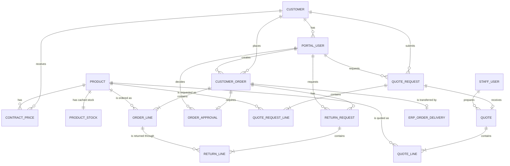

# Entity Model

Drafted from `docs/vision.md`; workflow states and entity boundaries should be validated against detailed requirements.

## Entity Relationship Diagram

### CUSTOMER

Represents a business customer that buys products through the portal.

| Attribute | Description | Data Type | Length/Precision | Validation Rules |
|-----------|-------------|-----------|------------------|------------------|
| id | Unique identifier | Long | 19 | Primary Key, Sequence |
| erp_customer_id | Customer identifier in the ERP | String | 100 | Not Null, Unique |
| name | Business customer name | String | 150 | Not Null |
| approval_limit | Order total above which the customer requires approval | Decimal | 10,2 | Optional |

### PORTAL_USER

Represents a buyer or purchasing manager belonging to a business customer.

| Attribute | Description | Data Type | Length/Precision | Validation Rules |
|-----------|-------------|-----------|------------------|------------------|
| id | Unique identifier | Long | 19 | Primary Key, Sequence |
| customer_id | Business customer | Long | 19 | Not Null, Foreign Key (CUSTOMER.id) |
| email | User email address | String | 255 | Not Null, Format: Email |
| first_name | User first name | String | 100 | Not Null |
| last_name | User last name | String | 100 | Not Null |
| role | User role | String | 50 | Not Null, Values: Buyer, Purchasing Manager |
| active | Whether the user account is active | Boolean | 1 | Not Null |

### STAFF_USER

Represents a sales representative or customer service employee using the portal.

| Attribute | Description | Data Type | Length/Precision | Validation Rules |
|-----------|-------------|-----------|------------------|------------------|
| id | Unique identifier | Long | 19 | Primary Key, Sequence |
| email | User email address | String | 255 | Not Null, Format: Email |
| first_name | User first name | String | 100 | Not Null |
| last_name | User last name | String | 100 | Not Null |
| active | Whether the user account is active | Boolean | 1 | Not Null |

### PRODUCT

Represents a product copy maintained in the portal from PIM data.

| Attribute | Description | Data Type | Length/Precision | Validation Rules |
|-----------|-------------|-----------|------------------|------------------|
| id | Unique identifier | Long | 19 | Primary Key, Sequence |
| pim_product_id | Product identifier in the PIM | String | 100 | Not Null, Unique |
| erp_product_id | Product identifier in the ERP | String | 100 | Not Null, Unique |
| name | Product name | String | 255 | Not Null |
| description | Product description | String | 500 | Optional |
| synchronized_at | Time the product data was synchronized | DateTime | - | Not Null |

### CONTRACT_PRICE

Represents a customer's contract price for a product during an effective period.

| Attribute | Description | Data Type | Length/Precision | Validation Rules |
|-----------|-------------|-----------|------------------|------------------|
| id | Unique identifier | Long | 19 | Primary Key, Sequence |
| customer_id | Business customer | Long | 19 | Not Null, Foreign Key (CUSTOMER.id) |
| product_id | Priced product | Long | 19 | Not Null, Foreign Key (PRODUCT.id) |
| unit_price | Contract price per product | Decimal | 10,2 | Not Null |
| valid_from | First date the price is effective | Date | - | Not Null |
| valid_to | Last date the price is effective | Date | - | Optional |
| synchronized_at | Time the contract price was synchronized | DateTime | - | Not Null |

#### Constraints

- The valid-to date must be on or after the valid-from date.
- A customer cannot have overlapping effective periods for the same product.

### PRODUCT_STOCK

Represents the most recently synchronized stock quantity for a product.

| Attribute | Description | Data Type | Length/Precision | Validation Rules |
|-----------|-------------|-----------|------------------|------------------|
| id | Unique identifier | Long | 19 | Primary Key, Sequence |
| product_id | Product with this stock quantity | Long | 19 | Not Null, Foreign Key (PRODUCT.id) |
| quantity | Synchronized stock quantity | Integer | 10 | Not Null |
| synchronized_at | Time the stock quantity was synchronized | DateTime | - | Not Null |

#### Constraints

- Each product has at most one current stock record.

### CUSTOMER_ORDER

Represents an order placed by a business customer's portal user.

| Attribute | Description | Data Type | Length/Precision | Validation Rules |
|-----------|-------------|-----------|------------------|------------------|
| id | Unique identifier | Long | 19 | Primary Key, Sequence |
| customer_id | Business customer placing the order | Long | 19 | Not Null, Foreign Key (CUSTOMER.id) |
| buyer_id | Portal user who created the order | Long | 19 | Not Null, Foreign Key (PORTAL_USER.id) |
| status | Current order processing state | String | 50 | Not Null, Values: Draft, Awaiting Approval, Approved, Rejected, Queued for ERP, Transferred to ERP, Cancelled |
| created_at | Time the order was created | DateTime | - | Not Null |

### ORDER_LINE

Represents a product and its ordered quantity and price within an order.

| Attribute | Description | Data Type | Length/Precision | Validation Rules |
|-----------|-------------|-----------|------------------|------------------|
| id | Unique identifier | Long | 19 | Primary Key, Sequence |
| customer_order_id | Order containing this line | Long | 19 | Not Null, Foreign Key (CUSTOMER_ORDER.id) |
| product_id | Ordered product | Long | 19 | Not Null, Foreign Key (PRODUCT.id) |
| quantity | Number of products ordered | Integer | 10 | Not Null |
| unit_price | Price per product recorded for this order | Decimal | 10,2 | Not Null |

### ORDER_APPROVAL

Represents a purchasing manager's decision on an order that requires approval.

| Attribute | Description | Data Type | Length/Precision | Validation Rules |
|-----------|-------------|-----------|------------------|------------------|
| id | Unique identifier | Long | 19 | Primary Key, Sequence |
| customer_order_id | Order being reviewed | Long | 19 | Not Null, Foreign Key (CUSTOMER_ORDER.id) |
| approver_id | Purchasing manager making the decision | Long | 19 | Not Null, Foreign Key (PORTAL_USER.id) |
| decision | Approval decision | String | 50 | Not Null, Values: Approved, Rejected |
| decided_at | Time the decision was made | DateTime | - | Not Null |

#### Constraints

- An order can have at most one approval decision.

### QUOTE_REQUEST

Represents a large-quantity pricing request submitted by a business customer.

| Attribute | Description | Data Type | Length/Precision | Validation Rules |
|-----------|-------------|-----------|------------------|------------------|
| id | Unique identifier | Long | 19 | Primary Key, Sequence |
| customer_id | Business customer submitting the request | Long | 19 | Not Null, Foreign Key (CUSTOMER.id) |
| requester_id | Portal user submitting the request | Long | 19 | Not Null, Foreign Key (PORTAL_USER.id) |
| status | Current request state | String | 50 | Not Null, Values: Requested, Quoted, Cancelled |
| created_at | Time the request was created | DateTime | - | Not Null |

### QUOTE_REQUEST_LINE

Represents a product and requested quantity in a quote request.

| Attribute | Description | Data Type | Length/Precision | Validation Rules |
|-----------|-------------|-----------|------------------|------------------|
| id | Unique identifier | Long | 19 | Primary Key, Sequence |
| quote_request_id | Request containing this line | Long | 19 | Not Null, Foreign Key (QUOTE_REQUEST.id) |
| product_id | Product for which pricing is requested | Long | 19 | Not Null, Foreign Key (PRODUCT.id) |
| requested_quantity | Number of products for which pricing is requested | Integer | 10 | Not Null |

### QUOTE

Represents the sales representative's pricing response to a quote request.

| Attribute | Description | Data Type | Length/Precision | Validation Rules |
|-----------|-------------|-----------|------------------|------------------|
| id | Unique identifier | Long | 19 | Primary Key, Sequence |
| quote_request_id | Request being answered | Long | 19 | Not Null, Foreign Key (QUOTE_REQUEST.id) |
| sales_representative_id | Staff user preparing the quote | Long | 19 | Not Null, Foreign Key (STAFF_USER.id) |
| status | Current quote state | String | 50 | Not Null, Values: Open, Accepted, Declined, Expired |
| issued_at | Time the quote was issued | DateTime | - | Not Null |
| valid_until | Last date the quote can be accepted | Date | - | Optional |

### QUOTE_LINE

Represents the quoted price and quantity for a product in a quote.

| Attribute | Description | Data Type | Length/Precision | Validation Rules |
|-----------|-------------|-----------|------------------|------------------|
| id | Unique identifier | Long | 19 | Primary Key, Sequence |
| quote_id | Quote containing this line | Long | 19 | Not Null, Foreign Key (QUOTE.id) |
| product_id | Quoted product | Long | 19 | Not Null, Foreign Key (PRODUCT.id) |
| quantity | Number of products covered by the quote | Integer | 10 | Not Null |
| unit_price | Quoted price per product | Decimal | 10,2 | Not Null |

### RETURN_REQUEST

Represents a return request for products from a placed order.

| Attribute | Description | Data Type | Length/Precision | Validation Rules |
|-----------|-------------|-----------|------------------|------------------|
| id | Unique identifier | Long | 19 | Primary Key, Sequence |
| customer_order_id | Order containing products to return | Long | 19 | Not Null, Foreign Key (CUSTOMER_ORDER.id) |
| requester_id | Portal user submitting the request | Long | 19 | Not Null, Foreign Key (PORTAL_USER.id) |
| status | Current return processing state | String | 50 | Not Null, Values: Requested, Approved, Rejected, Completed, Cancelled |
| created_at | Time the request was created | DateTime | - | Not Null |

### RETURN_LINE

Represents an order line and quantity included in a return request.

| Attribute | Description | Data Type | Length/Precision | Validation Rules |
|-----------|-------------|-----------|------------------|------------------|
| id | Unique identifier | Long | 19 | Primary Key, Sequence |
| return_request_id | Return request containing this line | Long | 19 | Not Null, Foreign Key (RETURN_REQUEST.id) |
| order_line_id | Original order line being returned | Long | 19 | Not Null, Foreign Key (ORDER_LINE.id) |
| quantity | Number of products requested for return | Integer | 10 | Not Null |

#### Constraints

- The total returned quantity for an order line cannot exceed its ordered quantity.

### ERP_ORDER_DELIVERY

Represents durable transfer state for sending an order to the ERP without duplicate deliveries.

| Attribute | Description | Data Type | Length/Precision | Validation Rules |
|-----------|-------------|-----------|------------------|------------------|
| id | Unique identifier | Long | 19 | Primary Key, Sequence |
| customer_order_id | Order to transfer | Long | 19 | Not Null, Foreign Key (CUSTOMER_ORDER.id) |
| idempotency_key | Key used to identify retries of the same transfer | String | 100 | Not Null, Unique |
| status | Current ERP transfer state | String | 50 | Not Null, Values: Pending, In Progress, Succeeded, Failed |
| attempt_count | Number of transfer attempts | Integer | 10 | Not Null |
| queued_at | Time the transfer was queued | DateTime | - | Not Null |
| last_attempt_at | Time of the most recent transfer attempt | DateTime | - | Optional |
| transferred_at | Time the ERP confirmed the transfer | DateTime | - | Optional |

#### Constraints

- An order can have at most one ERP delivery record.
